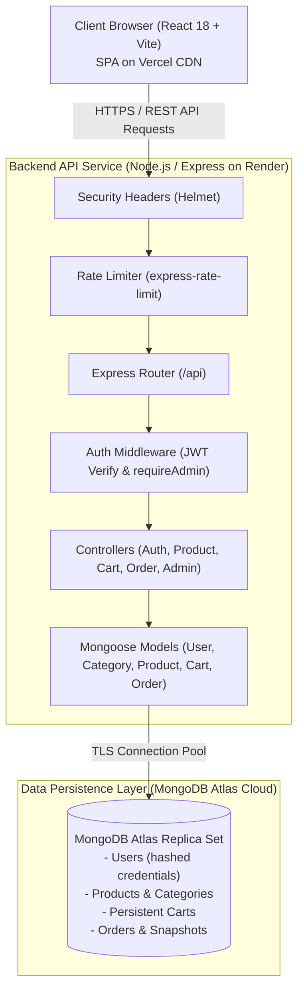

[](https://nodejs.org/)
[](https://react.dev/)
[](https://expressjs.com/)
[](https://www.mongodb.com/atlas)
[](https://vitejs.dev/)
[]()

ShopEasy is a modern, responsive, full-stack e-commerce web platform engineered for performance, financial accuracy, robust role-based security, and cloud scalability. Designed for real-world internship evaluation, it features persistent shopping carts, server-side price recalculation in integer paise, Cash on Delivery (COD) order processing with atomic stock deduction and rollback, and a comprehensive Administrator Dashboard with real-time analytics.

---

## 📑 Table of Contents
1. [Project Overview & Key Features](#-project-overview--key-features)
2. [System Architecture](#-system-architecture)
3. [Technology Stack](#-technology-stack)
4. [Folder Structure](#-folder-structure)
5. [Installation & Setup](#-installation--setup)
6. [MongoDB Atlas Configuration](#-mongodb-atlas-configuration)
7. [Environment Variables](#-environment-variables)
8. [Database Seeding & Default Admin](#-database-seeding--default-admin)
9. [Startup Commands](#-startup-commands)
10. [REST API Overview](#-rest-api-overview)
11. [Testing & Quality Assurance](#-testing--quality-assurance)
12. [Cloud Deployment (Render & Vercel)](#-cloud-deployment-render--vercel)
13. [Troubleshooting](#-troubleshooting)
14. [Screenshots & UI Walkthrough](#-screenshots--ui-walkthrough)
15. [Known Limitations & Roadmap](#-known-limitations--roadmap)

---

## 🌟 Project Overview & Key Features

### 🛒 Customer Experience
- **Responsive Product Catalog**: Browse products across categories with partial-match search, category filters, and price sorting (ascending/descending).
- **Product Detail Views**: Rich product photography, specifications, real-time stock availability badges, and category associations.
- **Persistent Shopping Cart**: Cross-session persistent cart stored in MongoDB Atlas; real-time quantity controls with automated stock boundary enforcement.
- **Server-Side Financial Accuracy**: All prices and order totals are calculated and stored in **integer paise** (1 INR = 100 paise) to eliminate IEEE 754 floating-point rounding drift.
- **Streamlined Checkout**: Cash on Delivery (COD) workflow with server-validated shipping addresses, PIN codes, and phone numbers.
- **Order Tracking & History**: Customers view only their own orders with immutable purchase snapshot prices, timestamps, and live statuses (`Placed`, `Shipped`, `Delivered`, `Cancelled`).
- **Safe Customer Cancellation**: Customers can cancel orders in `Placed` status; reserved inventory is atomically restored.

### 🛡️ Administrator Operations & Analytics
- **Live Business Intelligence**: Real-time sales aggregation excluding cancelled orders, total products, active customers, order count, and low-stock alerts.
- **Catalog Management**: Add, edit, deactivate, and delete products and categories with image URLs, stock controls, and featured flags.
- **Order Lifecycle Management**: View all customer orders, filter by status, and execute validated status transitions (`Placed` -> `Shipped` -> `Delivered`).
- **Customer Oversight**: View registered customers with scrubbed security fields (zero password hash exposure).

### 🔒 Enterprise Security
- **Bcrypt Password Hashing**: Passwords hashed with 10 salt rounds before storage; stripped from all API outputs.
- **JWT Authentication**: Secure Bearer tokens with strict expiration and centralized verification.
- **Role-Based Authorization**: Administrative APIs strictly enforce `role: 'admin'`; customers receive HTTP 403 Forbidden.
- **Role Elevation Prevention**: Registration hardcodes `role: 'customer'`, ignoring any client-supplied parameters.
- **Rate Limiting**: Brute-force protection on authentication endpoints via `express-rate-limit`.
- **Security Headers & CORS**: Hardened with `helmet` and origin-controlled CORS policies.

---

## 🏛 System Architecture



---

## 💻 Technology Stack

### Frontend (`/client`)
- **Core Library**: React.js 18
- **Build Tool & Dev Server**: Vite 6.0
- **Routing**: React Router DOM v6 (Declarative SPA routing with `ProtectedRoute` and `AdminRoute`)
- **HTTP Client**: Axios with centralized request/response error interceptors
- **Icons**: Lucide React
- **Styling**: Pure responsive CSS tokens (`variables.css`, `global.css`) without heavy external UI dependencies

### Backend (`/server`)
- **Runtime**: Node.js (v20+ LTS)
- **Web Framework**: Express.js 4.21
- **Module System**: ECMAScript Modules (`"type": "module"`)
- **Security**: Helmet, bcryptjs, express-rate-limit, cors
- **Authentication**: JSON Web Tokens (`jsonwebtoken`)
- **Testing**: Node.js Native Test Runner (`node:test`, `node:assert/strict`)

### Database
- **Engine**: MongoDB Atlas Cloud Database
- **ODM**: Mongoose 8.9+
- **In-Memory Test Engine**: `mongodb-memory-server` (for isolated, non-destructive automated testing)

---

## 📂 Folder Structure

```
ShopEasy-Ecommerce/
├── client/                             # Frontend React application
│   ├── public/                         # Favicon and static assets
│   ├── src/
│   │   ├── components/
│   │   │   ├── admin/                  # Admin product, category, and order management tabs
│   │   │   ├── common/                 # ProtectedRoute, AdminRoute, Pagination, SearchInput
│   │   │   ├── layout/                 # Navbar with cart badge, Footer, Layout wrapper
│   │   │   ├── orders/                 # OrderStatusBadge, CancelOrderModal
│   │   │   └── product/                # ProductCard, ProductGrid
│   │   ├── config/                     # API URL resolution and app constants
│   │   ├── context/                    # AuthContext and CartContext providers
│   │   ├── pages/                      # Home, Cart, Checkout, Orders, Admin, Auth pages
│   │   ├── routes/                     # AppRoutes route definitions
│   │   ├── services/                   # Axios API service clients
│   │   ├── styles/                     # CSS design tokens (variables.css, global.css)
│   │   ├── utils/                      # formatINR paise currency formatters
│   │   ├── App.jsx                     # Root React application component
│   │   └── main.jsx                    # Application entrypoint
│   ├── tests/                          # Frontend automated unit tests
│   ├── .env.example                    # Client environment template
│   ├── index.html                      # HTML root template
│   ├── package.json                    # Client package dependencies & scripts
│   ├── vercel.json                     # Vercel SPA routing rewrites configuration
│   └── vite.config.js                  # Vite configuration & dev proxy
│
├── server/                             # Backend Express API
│   ├── src/
│   │   ├── config/                     # Environment loader (env.js) & MongoDB connection (database.js)
│   │   ├── controllers/                # Request handlers (auth, product, cart, order, admin)
│   │   ├── middleware/                 # protect, requireAdmin, errorHandler, rateLimiter
│   │   ├── models/                     # User, Category, Product, Cart, Order Mongoose models
│   │   ├── routes/                     # API endpoint definitions
│   │   ├── scripts/                    # seedDatabase.js initial catalog and admin seeder
│   │   ├── utils/                      # token.js JWT generation utility
│   │   ├── app.js                      # Express application assembly
│   │   └── server.js                   # Server listen and graceful shutdown
│   ├── tests/                          # Backend automated test suites (75 integration tests)
│   ├── .env.example                    # Server environment template
│   └── package.json                    # Server package dependencies & scripts
│
├── docs/                               # Comprehensive project technical documentation
│   ├── API_DOCUMENTATION.md            # Complete REST API reference
│   ├── DATABASE_DESIGN.md              # MongoDB schema design & ER diagrams
│   ├── TESTING_GUIDE.md                # Testing strategy, suites, and execution instructions
│   └── DEPLOYMENT_GUIDE.md             # Production cloud deployment manual (Render & Vercel)
│
├── postman/                            # Postman collections
│   └── ShopEasy.postman_collection.json# Complete API testing collection
│
├── .gitignore                          # Global version control exclusions
├── package.json                        # Root npm orchestration workspace
├── render.yaml                         # Render Infrastructure-as-Code blueprint
└── README.md                           # Master project guide
```

---

## 🚀 Installation & Setup

### Prerequisites
- **Node.js**: v20.0.0 or higher ([Download Node.js](https://nodejs.org/))
- **npm**: v10.0.0 or higher
- **MongoDB Atlas Account**: Free tier cluster ([MongoDB Atlas](https://www.mongodb.com/atlas))

### Step 1: Clone the Repository
```bash
git clone https://github.com/your-username/ShopEasy-Ecommerce.git
cd ShopEasy-Ecommerce
```

### Step 2: Install Dependencies
Install dependencies for both frontend and backend using the root orchestration script:
```bash
npm run install:all
```

*(Alternatively, run `npm install` inside both `client/` and `server/` directories).*

---

## 🍃 MongoDB Atlas Configuration

1. Create a free **M0 Cluster** on [MongoDB Atlas](https://www.mongodb.com/cloud/atlas).
2. Under **Security** -> **Database Access**, create a user (e.g. `shopeasy_admin`) with **Read and write to any database** permissions.
3. Under **Security** -> **Network Access**, click **Add IP Address** and choose **Allow Access From Anywhere** (`0.0.0.0/0`) or add your current IP address.
4. Under **Deployment** -> **Database**, click **Connect** -> **Drivers** and copy your SRV connection URI:
   ```
   mongodb+srv://<username>:<password>@cluster0.xxxxx.mongodb.net/shopeasy?retryWrites=true&w=majority
   ```

---

## 🔐 Environment Variables

### Backend Configuration (`server/.env`)
Create `server/.env` by copying `server/.env.example`:
```bash


# On Windows PowerShell:
Copy-Item server/.env.example server/.env
```

Edit `server/.env` with your actual configuration:
```ini
PORT=5000
NODE_ENV=development
CLIENT_URL=http://localhost:3000
MONGODB_URI=mongodb+srv://<username>:<password>@cluster0.xxxxx.mongodb.net/shopeasy?retryWrites=true&w=majority
JWT_SECRET=your_super_secret_jwt_key_min_32_characters_long
JWT_EXPIRES_IN=7d

# Development Seeding
CREATE_DEV_ADMIN=true
DEV_ADMIN_EMAIL=admin@shopeasy.local
DEV_ADMIN_PASSWORD=AdminSecurePass123!
```

### Frontend Configuration (`client/.env`)
Create `client/.env` by copying `client/.env.example`:
```bash
# On Linux/macOS:
cp client/.env.example client/.env

# On Windows PowerShell:
Copy-Item client/.env.example client/.env
```

Contents of `client/.env`:
```ini
# Points to your local Express server in development
VITE_API_URL=http://localhost:5000/api
```

---

## 🌱 Database Seeding & Default Admin

Populate your MongoDB Atlas cluster with 4 initial categories and 16 diverse e-commerce products (with prices in integer paise):

```bash
# From project root:
npm run seed

# Or from server directory:
cd server
npm run seed
```

### Development Administrator Credentials
When `CREATE_DEV_ADMIN=true` is enabled, the seed script provisions a default administrator account:
- **Email**: `admin@shopeasy.local`
- **Password**: `AdminSecurePass123!`
- **Role**: `admin`

*(Existing administrators are preserved and never overwritten).*

---

## 🏃 Startup Commands

### Run Both Services Concurrently (Recommended)

Open two terminal windows:

**Terminal 1 (Backend API):**
```bash
npm run dev:server
# Server starts on http://localhost:5000
```

**Terminal 2 (Frontend Client):**
```bash
npm run dev:client
# Vite client starts on http://localhost:3000
```

### Single Terminal Execution
You can also run directly from within respective folders:
```bash
# Backend
cd server && npm run dev

# Frontend
cd client && npm run dev
```

---

## 🌐 REST API Overview

Detailed request/response schemas are documented in [`docs/API_DOCUMENTATION.md`](file:///d:/ShopEasy-Ecommerce/docs/API_DOCUMENTATION.md).

| Method | Endpoint | Access | Description |
| :--- | :--- | :--- | :--- |
| **GET** | `/api/health` | Public | System uptime & database connection check |
| **POST** | `/api/auth/register` | Public | Register customer (role elevated attempts ignored) |
| **POST** | `/api/auth/login` | Public | Login and obtain JWT Bearer token |
| **GET** | `/api/auth/me` | Authenticated | Retrieve authenticated user profile |
| **PUT** | `/api/auth/profile` | Authenticated | Update user contact and shipping address |
| **GET** | `/api/categories` | Public | List active product categories |
| **GET** | `/api/products` | Public | Search, filter by category, sort, and paginate products |
| **GET** | `/api/products/:id` | Public | Single product details with populated category |
| **GET** | `/api/cart` | Authenticated | Retrieve user cart with server-calculated totals |
| **POST** | `/api/cart` | Authenticated | Add item to cart with stock validation |
| **PUT** | `/api/cart/:itemId` | Authenticated | Update line item quantity |
| **DELETE**| `/api/cart/:itemId` | Authenticated | Remove item from cart |
| **POST** | `/api/orders` | Authenticated | Create COD order with safe atomic stock deduction |
| **GET** | `/api/orders` | Authenticated | List customer's own order history |
| **GET** | `/api/orders/:id` | Authenticated | Order details (guarded by owner/admin check) |
| **PATCH**| `/api/orders/:id/cancel`| Authenticated | Cancel `Placed` order & restore inventory once |
| **GET** | `/api/admin/stats` | Admin Only | Dashboard analytics (sales excluding cancellations) |
| **GET** | `/api/admin/orders`| Admin Only | Paginated order management for all customers |
| **PATCH**| `/api/admin/orders/:id/status`| Admin Only | Validated order status transitions |
| **GET** | `/api/admin/customers` | Admin Only | Customer list (zero password hash exposure) |
| **POST** | `/api/products` | Admin Only | Create catalog product |
| **PUT** | `/api/products/:id` | Admin Only | Update catalog product |
| **DELETE**| `/api/products/:id` | Admin Only | Delete catalog product |

---

## 🧪 Testing & Quality Assurance

ShopEasy includes an automated, non-destructive test suite running against an in-memory database (`mongodb-memory-server`) to guarantee tests never touch production data.

### Running All Tests
```bash
npm run test:all
```

### Running Backend Tests (75 Tests)
```bash
npm run test:server
```
**Test Suites Covered:**
- `health.test.js` (2 tests): Uptime & 404 handler.
- `models.test.js` (5 tests): Schema rules, integer paise validators, email constraints.
- `auth.test.js` (14 tests): Registration, duplicate emails, password security, login, JWT validation, role elevation protection, admin gates.
- `products.test.js` (13 tests): Pagination (8 per page), partial search, category filters, sorting, admin CRUD.
- `cart.test.js` (14 tests): Server-side price computation, stock limits, empty states, item cleanup.
- `orders.test.js` (15 tests): COD order placement, atomic stock deduction, order ownership (403), valid/invalid cancellation, duplicate cancellation prevention.
- `admin.test.js` (12 tests): Admin authorization, real revenue calculations, low-stock alerts, customer list security.

### Running Frontend Tests (10 Tests)
```bash
npm run test:client
```
**Test Coverage:**
- Input validation (email, password matching, phone numbers, PIN codes).
- Currency formatting in INR with integer paise (`formatINR`).
- Product stock badges & out-of-stock logic.
- Search and category filtering algorithms.
- Pagination slice bounds.
- Line totals and subtotal arithmetic.
- Route protection logic (`ProtectedRoute` and `AdminRoute`).
- Centralized API error response normalization.

---

## ☁️ Cloud Deployment (Render & Vercel)

Detailed step-by-step instructions are available in [`docs/DEPLOYMENT_GUIDE.md`](file:///d:/ShopEasy-Ecommerce/docs/DEPLOYMENT_GUIDE.md).

### Backend Deployment (Render)
1. Link your GitHub repository on [Render](https://render.com).
2. Create a **Web Service**:
   - **Root Directory**: `server`
   - **Build Command**: `npm install`
   - **Start Command**: `npm start`
   - **Health Check Path**: `/api/health`
3. Configure Environment Variables on Render:
   - `NODE_ENV`: `production`
   - `PORT`: `10000` (Render allocates this automatically)
   - `MONGODB_URI`: `<Your MongoDB Atlas Connection String>`
   - `CLIENT_URL`: `https://your-shopeasy-frontend.vercel.app`
   - `JWT_SECRET`: `<Secure random 64-character secret>`
   - `CREATE_DEV_ADMIN`: `true` *(first deployment only)*

### Frontend Deployment (Vercel)
1. Import your GitHub repository on [Vercel](https://vercel.com).
2. Configure Project Settings:
   - **Framework Preset**: `Vite`
   - **Root Directory**: `client`
   - **Build Command**: `npm run build`
   - **Output Directory**: `dist`
3. Configure Environment Variables on Vercel:
   - `VITE_API_URL`: `https://your-shopeasy-backend.onrender.com/api`
4. Deploy! The included [`client/vercel.json`](file:///d:/ShopEasy-Ecommerce/client/vercel.json) handles SPA routing rewrites automatically.

---

## 🔧 Troubleshooting

### 1. MongoDB Connection Timeout (`MongoServerSelectionError`)
- **Reason**: Your current IP is not added to the MongoDB Atlas Network Access whitelist.
- **Solution**: Go to MongoDB Atlas -> Network Access -> Add IP Address -> Select **Allow Access From Anywhere** (`0.0.0.0/0`) for development and dynamic cloud deployments.

### 2. CORS Error in Browser Console
- **Reason**: The backend's `CLIENT_URL` does not match the frontend's origin URL.
- **Solution**: Ensure `CLIENT_URL` in `server/.env` exactly matches your frontend address (e.g. `http://localhost:3000` locally, or `https://your-app.vercel.app` in production) without any trailing slash.

### 3. Port Already in Use (EADDRINUSE)
- **Reason**: Another process is occupying port 5000 or 3000.
- **Solution (Windows PowerShell)**:
  ```powershell
  Get-Process -Id (Get-NetTCPConnection -LocalPort 5000).OwningProcess | Stop-Process -Force
  ```

---

## 📸 Screenshots & UI Walkthrough

*(Screenshots can be added to a `docs/screenshots/` folder for visual submissions)*

| Screen | Description |
| :--- | :--- |
| **Homepage & Product Grid** | Responsive hero banner, category filter pills, partial-search bar, and responsive product cards with formatted INR prices (`₹4,999.00`). |
| **Product Detail Page** | Full product image showcase, detailed description, real-time stock indicator, and interactive Add to Cart controls. |
| **Shopping Cart** | Interactive item quantity controls (`+` / `-`), line total calculations, empty cart state, and order summary. |
| **Checkout (COD)** | Validated shipping form (Full Name, Phone, Address, City, PIN Code) and Cash on Delivery order summary. |
| **Customer Order History** | Interactive order history with status badges (`Placed`, `Shipped`, `Delivered`, `Cancelled`) and order cancellation dialog. |
| **Admin Dashboard** | Real-time business metrics (Active Sales, Total Orders, Low-Stock alerts) and quick management shortcuts. |
| **Admin Order Manager** | Filter orders by status, search by order number, inspect customer shipping details, and execute status transitions. |

---

## 🔮 Known Limitations & Roadmap

1. **Payment Methods**: Currently supports Cash on Delivery (COD). Planned integration for Razorpay / Stripe online payment gateways in future stages.
2. **Email Notifications**: Order confirmation is currently delivered in-app. Future releases will add automated transactional emails via SendGrid / Nodemailer.
3. **Multi-Image Support**: Products currently feature a single high-resolution primary image. Planned support for multi-image product carousels with AWS S3 / Cloudinary uploads.
4. **Product Reviews & Ratings**: Foundation laid in data models; customer rating interface planned for subsequent phase.

---

## 📜 License
This project is developed for educational and internship evaluation purposes under the ISC License.

