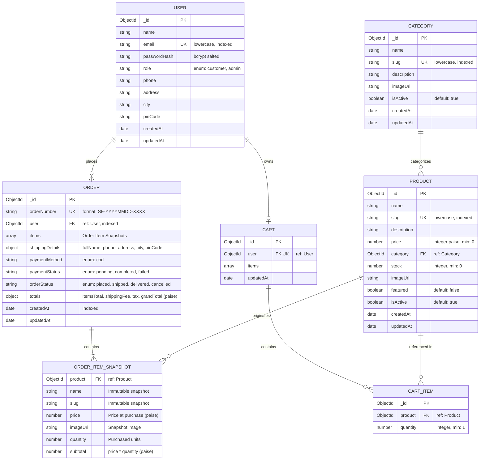

# ShopEasy Database Architecture & Schema Design

Comprehensive documentation of the MongoDB Atlas database schema, models, indexing strategies, financial integrity rules, and entity-relationship architecture for ShopEasy.

---

## 1. Database Overview

- **Database Engine**: MongoDB Atlas (v7.0+ / v8.0+)
- **Object Data Modeling (ODM)**: Mongoose 8.x
- **Monetary Unit**: Integer **Paise** (1 INR = 100 paise; e.g. ₹1,499.00 = `149900`)
- **Isolation & Concurrency**: Atomic conditional operators (`$gte`, `$inc`, `$set`) and snapshot preservation.

---

## 2. Entity-Relationship Diagram (ERD)



---

## 3. Financial Integrity: Integer Paise Standard

### The Floating-Point Problem
Standard IEEE 754 floating-point arithmetic used in programming languages introduces precision errors during fractional addition and multiplication:
```javascript
0.1 + 0.2 === 0.30000000000000004 // true!
```
In an e-commerce platform, accumulating fractional floating-point drift creates reconciliation mismatches between order line totals, cart subtotals, tax calculations, and payment audits.

### The ShopEasy Solution
All monetary values (product prices, cart item totals, shipping charges, and order grand totals) are strictly stored and computed as **positive integers representing Paise**:
- **₹1.00** = `100` paise
- **₹799.00** = `79900` paise
- **₹4,999.50** = `499950` paise

All Mongoose schema definitions enforce `validate: Number.isInteger` on monetary fields. Display conversion to INR currency strings (`₹4,999.00`) is handled safely via `Intl.NumberFormat('en-IN', ...)` or Mongoose virtual getters (`priceInRupees`), ensuring no rounding drift ever touches the database.

---

## 4. Detailed Collection Specifications

### 4.1. `users` Collection
Stores customer and administrator profiles, credentials, and default shipping coordinates.

```javascript
{
  name: { type: String, required: true, trim: true, minlength: 2, maxlength: 60 },
  email: {
    type: String,
    required: true,
    unique: true,
    lowercase: true,
    trim: true,
    match: [/^[^\s@]+@[^\s@]+\.[^\s@]+$/, 'Please provide a valid email']
  },
  passwordHash: { type: String, required: true, select: false },
  role: { type: String, enum: ['customer', 'admin'], default: 'customer' },
  phone: { type: String, trim: true },
  address: { type: String, trim: true },
  city: { type: String, trim: true },
  pinCode: { type: String, trim: true },
  createdAt: { type: Date, default: Date.now },
  updatedAt: { type: Date, default: Date.now }
}
```
**Indexes**:
- `{ email: 1 }` (Unique, Sparse)

---

### 4.2. `categories` Collection
Stores catalog categories with friendly URL slugs and active flags.

```javascript
{
  name: { type: String, required: true, trim: true, unique: true },
  slug: { type: String, required: true, unique: true, lowercase: true, trim: true },
  description: { type: String, trim: true, default: '' },
  imageUrl: { type: String, trim: true, default: '' },
  isActive: { type: Boolean, default: true },
  createdAt: { type: Date, default: Date.now },
  updatedAt: { type: Date, default: Date.now }
}
```
**Indexes**:
- `{ slug: 1 }` (Unique)
- `{ isActive: 1 }`

---

### 4.3. `products` Collection
Stores product inventory items, category references, and pricing.

```javascript
{
  name: { type: String, required: true, trim: true, minlength: 3, maxlength: 120 },
  slug: { type: String, required: true, unique: true, lowercase: true, trim: true },
  description: { type: String, required: true, trim: true },
  price: {
    type: Number,
    required: true,
    min: [0, 'Price must be non-negative'],
    validate: { validator: Number.isInteger, message: 'Price must be integer paise' }
  },
  category: { type: mongoose.Schema.Types.ObjectId, ref: 'Category', required: true },
  stock: {
    type: Number,
    required: true,
    min: [0, 'Stock cannot be negative'],
    default: 0,
    validate: { validator: Number.isInteger, message: 'Stock must be integer units' }
  },
  imageUrl: { type: String, required: true, trim: true },
  featured: { type: Boolean, default: false },
  isActive: { type: Boolean, default: true },
  createdAt: { type: Date, default: Date.now },
  updatedAt: { type: Date, default: Date.now }
}
```
**Indexes**:
- `{ slug: 1 }` (Unique)
- `{ category: 1, isActive: 1 }`
- `{ name: 'text', description: 'text' }` (Text search index)
- `{ price: 1 }` (Sorting)
- `{ createdAt: -1 }` (Sorting)

---

### 4.4. `carts` Collection
Persistent server-side shopping cart belonging to a registered user.

```javascript
{
  user: { type: mongoose.Schema.Types.ObjectId, ref: 'User', required: true, unique: true },
  items: [
    {
      product: { type: mongoose.Schema.Types.ObjectId, ref: 'Product', required: true },
      quantity: {
        type: Number,
        required: true,
        min: [1, 'Quantity must be at least 1'],
        validate: { validator: Number.isInteger, message: 'Quantity must be an integer' }
      }
    }
  ],
  createdAt: { type: Date, default: Date.now },
  updatedAt: { type: Date, default: Date.now }
}
```
**Indexes**:
- `{ user: 1 }` (Unique)

---

### 4.5. `orders` Collection
Immutable order ledger storing purchase snapshots, totals, and statuses.

```javascript
{
  orderNumber: { type: String, required: true, unique: true, uppercase: true },
  user: { type: mongoose.Schema.Types.ObjectId, ref: 'User', required: true, index: true },
  items: [
    {
      product: { type: mongoose.Schema.Types.ObjectId, ref: 'Product', required: true },
      name: { type: String, required: true },
      slug: { type: String, required: true },
      price: { type: Number, required: true },
      imageUrl: { type: String, required: true },
      quantity: { type: Number, required: true, min: 1 },
      subtotal: { type: Number, required: true }
    }
  ],
  shippingDetails: {
    fullName: { type: String, required: true },
    phone: { type: String, required: true },
    address: { type: String, required: true },
    city: { type: String, required: true },
    pinCode: { type: String, required: true }
  },
  paymentMethod: { type: String, enum: ['cod'], default: 'cod' },
  paymentStatus: { type: String, enum: ['pending', 'completed', 'failed'], default: 'pending' },
  orderStatus: {
    type: String,
    enum: ['placed', 'shipped', 'delivered', 'cancelled'],
    default: 'placed',
    index: true
  },
  totals: {
    itemsTotal: { type: Number, required: true },
    shippingFee: { type: Number, default: 0 },
    tax: { type: Number, default: 0 },
    grandTotal: { type: Number, required: true }
  },
  createdAt: { type: Date, default: Date.now, index: true },
  updatedAt: { type: Date, default: Date.now }
}
```
**Indexes**:
- `{ orderNumber: 1 }` (Unique)
- `{ user: 1, createdAt: -1 }` (User order history)
- `{ orderStatus: 1, createdAt: -1 }` (Admin dashboard filtering)

---

## 5. Architectural Patterns

### 5.1. Order Item Snapshot Pattern
When a customer places an order, the application copies the product's `name`, `slug`, `price`, `imageUrl`, and calculated `subtotal` directly into the order document.
- **Benefit**: If a seller later edits a product's name or increases its price to ₹2,499.00, past customer invoices and receipts maintain historical truth at the original purchase price (e.g. ₹1,499.00).
- Even if a product is deactivated or deleted from the catalog, order history records remain completely intact.

### 5.2. Atomic Inventory Deduction & Compensating Rollback
To prevent race conditions where concurrent checkouts oversell limited stock:
1. When supported by MongoDB Atlas replica sets, MongoDB multi-document transactions encapsulate stock deduction, order record creation, and cart clearing.
2. In single-node or standalone environments, conditional atomic updates are executed:
   ```javascript
   Product.findOneAndUpdate(
     { _id: productId, stock: { $gte: quantity } },
     { $inc: { stock: -quantity } },
     { new: true }
   );
   ```
3. If any item in a multi-item cart has insufficient stock, a compensating rollback reverses all previously deducted units before returning HTTP 400.

### 5.3. Double Cancellation Prevention
Order cancellation uses an atomic status check:
```javascript
Order.findOneAndUpdate(
  { _id: orderId, orderStatus: { $in: ['placed', 'pending'] } },
  { $set: { orderStatus: 'cancelled' } },
  { new: true }
);
```
Only if the order document was successfully transitioned from `placed` to `cancelled` is inventory stock incremented back. Subsequent attempts or concurrent requests fail the query filter, guaranteeing that stock cannot be restored twice.
